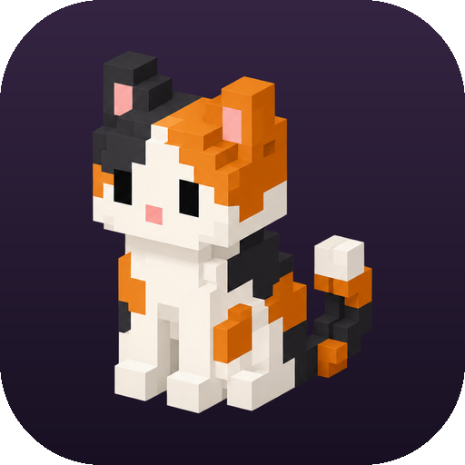
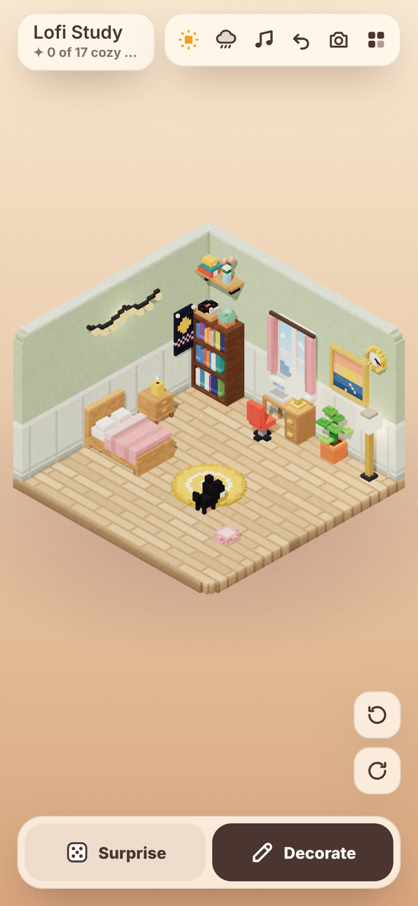
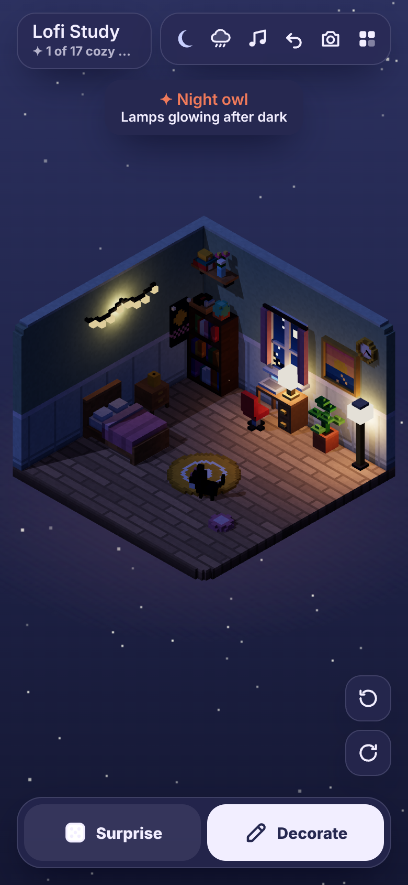
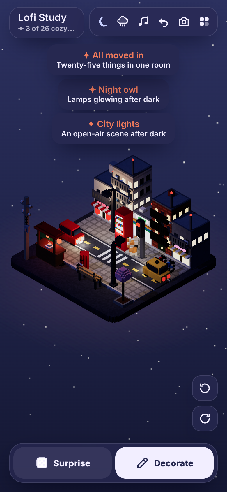

<p align="center"></p>

<h1 align="center">Lofi Rooms</h1>

<p align="center">Build tiny cozy isometric voxel rooms on your phone or on the web. Switch on the lamps, put a record on and let the cats wander.</p>

<p align="center">
  
  
  
</p>

A sibling of [Voxel Worlds](https://github.com/dalecri/voxel-worlds): same Explore and Edit idea, same touch controls, same Android build. Instead of landscapes, you make little rooms.

## Play in your browser

Once `main` is published to GitHub Pages: **[dalecri.github.io/Voxel-lofi-room](https://dalecri.github.io/Voxel-lofi-room/)**. It works on phones and computers.

To run it yourself:

```bash
python -m http.server 5180
```

Then open http://localhost:5180.

## What you can do

- **Decorate from scratch.** Over 410 voxel pieces in 22 groups.
- **Ten theme packs** for building intricate rooms and scenes, each with its own pieces, wall and floor styles, templates and a cozy moment:
  - **Bar & café:** a back bar of glowing bottles, beer taps, an espresso machine, a jukebox, a pool table, booths and neon. Templates: The Night Owl Bar, Corner Café.
  - **Library:** tall bookcases, gallery walkways, a rolling ladder, a spiral stair, a card catalog, banker's lamps, a lectern and a grandfather clock. Templates: Old Library, Reading Room.
  - **Future lab:** a holo table, bubbling lab benches, monitor walls, server racks, cryo pods, a robot arm and drones. Template: Future Lab.
  - **Spaceship:** porthole windows, a pilot console, a teleporter pad, a reactor core, alien plants and floating orb lamps. Templates: Starship Cabin, Alien Bridge.
  - **Mexican casa:** Talavera counters, a comal, a hammock, an ofrenda, papel picado, plus casitas, a parroquia, a kiosco, a fountain and a taco stand for the Pueblo Plaza scene.
  - **Old Europe:** a four-poster bed, a tile stove, a gramophone, a birdcage, plus half-timbered and canal houses, a bakery, a café terrace and a cathedral for the Old Town Square scene.
  - **Castle:** a great hall with a hearth, torches, banners, armour and a treasure chest, plus walls, towers, a gatehouse and a forge. Templates: Great Hall, Castle Keep.
  - **Caves:** blocky stone, glowing ores and crystals, lava, a furnace, a crafting table and mine rails, for a Crystal Cave and a Mine Hideout.
  - **Cyberpunk:** a capsule bed, a hacker rig, holo pets, neon signs, plus megatowers, a sky rail, flying cars and food carts for the 24×24 Neo City scene.
  - **Zen garden:** raked gravel, stepping stones, ponds, an arched bridge, a torii, a shishi-odoshi, maples, a tea house and lanterns, for the Zen Garden and Moon Viewing Deck.
- **The original collection:**
  - **Streets and scenes:** road, crosswalk, sidewalk, tram track, grass and canal tiles; shop buildings, apartment blocks, a corner store and brick walk-ups whose windows light up; street lamps, a traffic light that cycles, power poles, benches, a bus shelter, bikes, a ramen stall, little cars with headlights, a scooter, a post box, cones, hydrants, bins, street trees, railings, stairs and a tram that runs along its line.
  - **Japanese:** tatami mats, a kotatsu that warms up, a futon the cats nap on, a low table, zabuton cushions, a step chest, a folding screen, a glowing shoji screen, a waving lucky cat, daruma, ikebana, a kokeshi doll, a matcha set, a steaming bowl of ramen, a sakura tree that drops petals, bamboo, a koi pond, a vending machine, red paper lanterns, an andon lamp, a stone lantern, katakana neon (コーヒー, ラーメン, ネコ), a noren curtain, hanging scrolls, a folding fan and a sliding shoji window. Plus shoji, washi, cedar and wave-paper walls and tatami, engawa and garden stone floors.
  - **Furniture:** bed, sofa, armchair, coffee table, side table, piano, fireplace, beanbag, pouf and four rugs.
  - **Desks and storage, IKEA-style modular:** desk, corner desk, standing desk (tap to raise it), gaming desk with an RGB edge, trestle desk, cube shelves, sideboard, wardrobe with doors that open, bookshelf, dresser, pegboard, wall shelf and wall cubbies.
  - **Tech and games:** an iPad mini, an iPhone on a stand (its lock screen shows the real time), an ultrawide gaming monitor with RGB underglow (it spans two desk cells), an RGB gaming PC with a glass front, bookshelf speakers that pulse to the music, computer, PC tower with RGB fans, TV, retro TV, game console, handheld, arcade cabinet, **Barnaby's arcade** (a second cabinet that opens the full Barnaby's Dandelion Odyssey glide game in an overlay, with its saved progress), speaker, guitar, projector screen, laptop, record player, typewriter and a clock radio.
  - **Kitchen and drinks:** mini fridge (the door opens), tea cup, teapot, kettle, coffee maker, a microwave with a hinged door and soft beep (stainless, black or cream), mug, kitchen counter with a sink, bar stool and a fruit bowl.
  - **Lights:** an overhead pendant lamp (amber, frosted white or smoked green) placed on the floor grid above tables, arc lamp, paper lantern, tripod lamp, desk lamp, moon lamp, mushroom lamp, lava lamp, salt lamp, RGB light bar, LED strip, floor and table lamps, candles, fairy lights, wall lamp and neon signs.
  - **Decor:** a glass water bong, shisha, aquarium, fishbowl, snow globe, globe, diffuser, cat plush, record crate and a pampas vase.
  - **Plants:** monstera, snake plant, fiddle leaf fig, cactus, bonsai, trailing pothos, herbs, succulent, flowers and a wall planter.
  - **Windows:** curtains, blinds, a picture window, a round window and an arched window. Each one throws a sunbeam across the floor that changes with the time of day, and closed blinds make it striped.
  - **Wall art:** music posters (13 loose takes on artists' best-known covers), movie posters (7 made-up films), paintings, posters, a framed record, a wall clock and a mirror.
  - **Pets:** cats, cat beds, cat trees and a robot vacuum.
- **Twenty more furniture themes:** 160 free pieces, with three coordinated palettes per piece. Find each theme as its own group in Decorate → Add: Sugar shack, Laurentian cabin, Pottery studio, Home gym, Observatory, Campsite, Japanese minka, Scandinavian hygge, Moroccan riad, 70s retro lounge, 80s arcade, Art deco speakeasy, Wild west saloon, Viking longhouse, Ancient Egypt, Steampunk workshop, Treehouse, Bakery and patisserie, Music studio, and Finnish sauna. Tap the pottery wheel to spin it, switch the orrery and lamps on or off, play the saloon piano or arcade game, and put jazz on with the gramophone. These use the existing interactions and stay ordinary free furniture.
- **Sliding glass door:** a free three-cell-wide door in Doors, with oak, walnut and white frames. Its right panel slides over the left. The microwave and sliding door stay open until tapped again, using the existing saved on/off state.
- **Small things stack.** Mugs, lamps, plants and records sit on desks, tables, dressers, bookshelves, the piano, the mantel and wall shelves. Move a desk and everything on it comes along.
- **Five decorating tools:**
  - **Add:** tap or drag to place.
  - **Move:** drag pieces around, or drop one onto another to use them together.
  - **Turn:** tap to rotate.
  - **Paint:** change walls, wall colours, floors and the plot size (10×10 up to 24×24), or tap any piece to cycle its colours.
  - **Remove:** tap to put things away.
  
  Beds, sofas, desks and shelves back up against the nearest wall on their own.
- **Tap things to use them.** Almost everything does something:
  - Screens show real pixel animations. The computer boots up, then cycles through code, a platformer game, a music visualizer and a fish screensaver. The TV has cartoons, nature, a game and the news. The arcade plays a space shooter, and the projector shows a little movie.
  - The game console switches the TVs to the game. The fish tank light turns on and off and the fish dart around. Blinds go up and down.
  - The fridge and wardrobe doors swing open. The kettle whistles and steams, the coffee maker gurgles, the tea cup steams gently, and the shisha bubbles and puffs smoke.
  - The globe spins, the snow globe snows, the guitar strums, the typewriter clacks and the robot vacuum beeps and zooms off.
  - Lamps, candles, fairy lights, LED strips, RGB lights, the lava lamp and the fireplace switch on and off.
  - The record player is a little radio: each tap steps to the next station (Lofi radio, then your own stations, then off) and a small note names it.
  - Windows open and close their curtains.
  - The piano plays a phrase and the clocks tell the real time.
  - Mugs steam, and plants enjoy a watering.
  - Tap the bed to sleep until morning.
- **Cozy extras that do something:**
  - A **cuckoo clock** whose bird pops out when tapped and calls the hour on its own.
  - **Incense** that burns with a slow curl of smoke.
  - A **ceiling fan** that spins while it's on.
  - A **Currently reading** stack that reads you a line.
  - A **wall calendar** showing today's real date that flips its page.
  - A **bird feeder** that birds visit in the morning, or whenever you scatter seed.
  - A **radiator** with heat shimmer.
  - A **jukebox** that switches the music between five moods: Late night lofi, Rainy day jazz, Sunny morning, Chillhop bounce, Dreamy ambient.
  - A **telescope** that finds constellations after dark.
  - A **food bowl** the nearest cat runs over to.
  - Switching a fish tank's light on drops in breakfast, and the fish swarm the flakes.
- **Drag one thing onto another** with Move and they work together (the target lights up and tells you what will happen):
  - mug or tea cup → coffee maker or espresso machine: a fresh cup
  - plant → sink: watered
  - vinyl record → record player, gramophone or jukebox: plays that record's mood
  - cat treats → a cat: a happy snack
  - folded blanket → cat bed or futon: tucked in, and naps there last three times longer
  - fish food → any tank: feeding time
- **Cats:** Cali (calico), Neo (tuxedo), Ramses (savannah), Diego (bengal) and Mochi (grey).
  - When lofi is playing, cats near the music bop their heads to the beat.
  - Now and then a cat knocks a small thing off a table, and the toast names the culprit ("Ramses did it"). Tap it to pick it back up. You can turn this off in Settings.
  - A cat you've just petted follows your taps around for a few seconds.
  - When it rains, cats go and sit at the windows to watch, and they nap more.
  - Biscuit, the neighbour's ginger cat, wanders in now and then, hangs out and goes home. You can turn this off in Settings too.
  - They wander, hop onto sofas, beds, chairs and cat trees, and nap in cat beds.
  - Tap a cat to pet it and it purrs.
- **Music that follows your day.** The radio picks a mood for the time of day: morning bossa, afternoon chillhop, evening lofi, night ambient, and jazz when it rains. Jukeboxes cycle through the moods, or back to following the day, and vinyl records pick one.
  - While it plays, fairy lights, LED strips and RGB pieces pulse on the beat.
  - The ultrawide and the computer have a visualizer channel that dances to it.
- **A room that sounds like itself.** There are no ambience switches; the mix comes from what's in the room, and every layer fades in and out smoothly.
  - **From the furniture and things that are on:** a crackling fire, a clock ticking, faint neon buzz, keyboard clacks when a computer is on, the fish tank bubbler, the odd hiss from a hot mug.
  - **From the weather:** rain on the glass, a heavy storm with distant thunder, soft wind for snow and clear nights, crickets on summer nights, birds in the morning.
  - **Always there:** a barely-there room tone, rare house creaks, a distant city hum in scenes and gamer setups, and the rare soft meow.
  - **In cat view:** sounds are louder the closer you are, so the fire gets louder as you walk up to it.
  - **Taps sound like the thing:**
    - lamps click (each style a little different), neon crackles on, fires whoosh (bigger the first time in a room), candles strike a match
    - sofas poof, desk chairs squeak, beds rustle, books flip, curtains swish, mugs sip softly, plants get a trickle
    - the piano plays the next notes of a tune, and wall clocks chime on the hour
  - **Decorating:**
    - placing lands with a weight-matched thud: a mug clinks, a wardrobe thuds
    - removing is a papery poof, and invalid spots get a gentle bonk
    - wall paint rolls, floors get brushed, colour swaps click
  - **Cats:** they thump when they jump down, crash and scurry when they knock things over, and sigh when they claim a cat bed.
- **A record player that's a radio.** Station 1 is the built-in lofi band, which always works offline. It's one layer of the room's mix: the vinyl crackle sits under it, it dips for a moment when you tap or place something, rain adds a little more hiss and late at night it slows down a touch. Add your own stations in the Sound tab by choosing an icon and pasting a direct stream link (an .mp3 or an Icecast/Shoutcast URL); they play when you're online, and if one can't be reached the radio says so and goes back to Lofi radio. YouTube links can't play inside the app, so it'll tell you instead.
- **Generative lofi music.** Warm 9th chords, a lazy swung beat, a bassline and a soft vinyl crackle (switch it off in Settings), all synthesized live, so there are no audio files. Rain and the fireplace have their own ambience.
- **Time of day and weather.** Morning, afternoon, evening and night follow your clock, or you can tap the sun to pick one. At night the lamps light the room.
  - Tap the cloud to cycle the weather: **clear**, **rain**, **storm**, **snow** and **sakura**.
  - **Rain:** falls in slanted voxel streaks.
  - **Storm:** heavier rain blown hard by the wind, a darker sky, lightning bolts with a flash and thunder.
  - **Snow:** tumbling flakes.
  - **Sakura:** fluttering pink petals.
  - In a walled room the weather falls outside, around the diorama, so you're cozy indoors. On an open plot it falls right onto the scene, and rain leaves little splash rings.
- **Turn the room.** Walls facing you are cut away automatically, the same way the Sims does it, so you can decorate all four walls.
- **Scene mode.** Pick the **Open plot** wall style (in Paint, Walls) to remove all four walls and build an open diorama instead, like a city corner or a tram stop. Start one from the Neon Alley, Tram Stop or Empty Plot templates, or from **City Block**, a 20×20 crossroads with four corners of shops, a tram line, a canal and a park.
- **Bigger plots.** In Paint, Plot size, grow any room or scene from the cozy 10×10 to 14×14, 20×20 or 24×24 for multi-block cities. Pieces stay where they are when it grows, and it only shrinks once nothing would fall off the edge.
- **Cat view.** Tap the paw button (or press <kbd>C</kbd>) to see the room in first person through a cat's eyes. Up close, at cat height, with all four walls up.
  - The camera rides along as the cat wanders, and you drag to look around.
  - Tap the floor to walk there, and tap things to use them. On a computer, WASD or the arrow keys walk too.
  - **Next cat** hops into another cat's head, and **Back to room** returns to the diorama.
- **A connected house.** Join your saved rooms with doors and walk between them.
  - The **Doors** tab has twelve styles that each open their own way:
    - panel, cottage, old wooden (arched, with iron straps), glass, French doors, sliding barn, shoji, sliding glass patio
    - a sci-fi door that slides up, a bead curtain and a stone archway
    - a free-standing doorway, so streets, gardens and other open scenes can join in
  - Tap one and pick a room or a new one. The other side gets a matching door leading back automatically.
  - In cat view, just walk into a doorway. You arrive in the next room as the same cat.
  - The menu's **Your house** map shows every room and where its doors go. Tap a door to travel, or tap **Change** to send it somewhere else.
- **Share a room.** Tap the share icon in the top bar, **Share with link** on a photo, or **Share this room** at the top of the Rooms tab. You get a picture card as a 4:5 **Post** or a 9:16 **Story** (words and QR kept clear of story bars), signed off with the app icon, with **Share picture & link** and **Copy link** up front. The room code and the voxel QR sit folded under **More ways to share**. The voxel QR follows the Voxel QR Tree generator: a white plate seen from above as an upright square, coloured blocks on a deep background (the three corner squares in one even dark shade, and pale shades deepened just enough for cameras), in 🌸 blossom, 🍁 maple, 🌲 pine or ❄️ frost (remembered on the device), with **Plain** for a simple black-and-white code. The picture card's QR wears the same theme and repaints when you change it. When the room has a short link, a **Short link / Full room code** switch picks what the voxel QR holds: the short link (small, chunky, opens in any phone camera; the default) or the whole room (dense, works offline when scanned in Lofi Rooms). Every voxel QR is decoded once before it's shown; if it doesn't read back, Plain is used.
- **The logo.** A lit window at night with a cat on the sill, built from voxels (`scripts/logo.html`). `python3 scripts/make-logo.py` renders it into `assets/icon.png` (favicon, share-card sign-off, link preview) and the `resources/` icon, adaptive-icon layers and splash screens; then `npm run icons` rebuilds the Android launcher icons and `python3 scripts/make-og-card.py` repaints the preview.
- **Link previews and the app.** Pasting a share link in a chat shows a cozy preview card (`assets/og-card.jpg`, regenerate with `python3 scripts/make-og-card.py` after `npm run build`). Every link shares the same preview, since the room code after the `#` never reaches a server. On Android, links to `heycristobal.com/Voxel-lofi-room` open straight in the installed app (verified App Links); this needs `/.well-known/assetlinks.json` on heycristobal.com (in the `dalecri.github.io` repo) listing `com.lofirooms.app` and the SHA-256 of `android/app/debug.keystore`.
- **Who it's from.** Under the share buttons, **From Cris · Change** (or **Add your name**) sets the name friends see; it's the same name the guest book uses and rides inside the link. A friend's first screen then reads **A room from Cris**, with the card tucked in its envelope and a warm "Step inside whenever you like." The **Short link** setting lives under **More ways to share**.
- **Guest book polish.** All eight stickers fit on one row, and after signing, the long note code is folded under **Send the code instead**.
- **Sharing a friend's room.** While visiting, Share passes their room on as "this Lofi Room" (never "my room") and offers **Share my own room instead**.
- **Short links.** On by default: sharing saves the room (or guest-book note) code once in the `lofi-rooms` Supabase project and shares `heycristobal.com/Voxel-lofi-room/#r/<8 characters>`, so links stay tidy and the card's QR gets big, easy-to-scan squares. The same room always gets the same id. Clients can only call two functions, `shorten_room_link(code)` and `room_link(id)`; the `room_links` table itself can't be listed or changed. Untick **Short link** in the share sheet to keep everything inside the link with nothing stored online; if the shortener can't be reached, the full link is used and the sheet says so. Free Supabase projects pause after about a week idle, so `.github/workflows/keep-supabase-awake.yml` looks up a short link every Monday and Thursday; if it ever fails, restore the project from the Supabase dashboard. Short links open from the address bar, the Android app (`lofirooms://open?r=…` and App Links), the paste box and the in-app QR scanner, which now also accepts share-card QRs.
- **Shared cards are kept.** Each picture card you send (post or story) also lands in **Files › Photos** as a lighter JPEG, once per card. Cancelling the share sheet keeps nothing. Sharing a room the first time (card, link, or code) unlocks the **Open door** cozy moment.
- **Friends’ room cards** keep invitations privately on this device. Paste or scan a room code: a sealed pixel envelope arrives, opens into a real room preview with its name and details, and offers **Visit this room**. Nothing changes until you choose to visit. Reopen a saved card for the same open-card view, without replaying the arrival; duplicate invitations reuse their card, and a new code for the same shared room updates it. Remove cards with the two-tap × action. Reduced motion skips the animation. Visiting does not add the room to your home unless you save it; existing save-before-leaving and guest-book flows stay intact. Cards use the existing Store under `lr.friendCards` and are excluded from room codes.
- **A home that saves itself.** Rooms already in Your home autosave every few seconds and before travel, pause or closing. New rooms, Surprise rooms and friends' rooms stay unsaved until you choose to keep them; leaving an edited unsaved room still asks. In Rooms, tap the star on a room card to make it your **Main bedroom** at startup. A star on an unsaved room saves it first. Tap the filled star again to return to opening the last room visited. An unsaved experiment is preserved with a **Resume unsaved room** shortcut if startup takes you to your bedroom.
- **Your home as a village.** Rooms appear as static dioramas along a winding map in the Rooms tab, with their names underneath and a warm glow around your current room. Tap a diorama to travel, or **New room** to open the templates. Only rooms linked by portal doors have signposted paths. Thumbnails render lazily at 240px using the existing picker context, cache by room id and decor fingerprint, and never include private widget/file surfaces. Saved-room autosave, deletion, unsaved-room Save and the main-bedroom setting keep their existing behavior.
- **Seasonal decor:**
  - **Halloween:** a jack-o'-lantern, a pumpkin pile, a friendly ghost, a spider web, a bat garland and a candy bowl.
  - **Winter holidays:** a tree, a wreath, stockings, gifts, a snowman and hot cocoa.
  - The set that fits today's date moves to the front of the Add tray, with a one-time hint.
- **Control Centre houses your tools and apps.** The toolbox toolbar button opens a searchable app grid: Typewriter, future-self letters, groceries, ideas, tea, savings, pixel maker, French flashcard, whiteboard, focus candle, wardrobe, files, photos and more. These open their real tools even before you place the furniture. Apps launched here put **Back to Control Centre**, the centered app title, and Close on a shared top row; tool controls sit below it. Control Centre and the phone share the same app directory, including portal destinations and private custom links. Room controls live in Settings.
- **A Talavera casa.** The Talavera catalog category has 15 coordinated pieces in cobalt/sunflower, jade/ochre and terracotta/cobalt palettes: dining and coffee tables, bedside table, garden bench, dining chair, tiled bed, sideboard, display shelf, vase, leafy planter, jarrito, ceramic lamp, wall plates, mirror and woven rug. They match the original Talavera counter and existing tile walls.
- **Several rooms.** Start from one of 29 templates, split into collapsed Rooms and Scenes groups in the menu, or tap **Surprise** for a random themed room. Tap the room name to rename it.
- **55 cozy moments** to find, such as *Night owl*, *Golden hour*, *Stormy tea*, *Moonlight sonata*, *Cat parliament* and *Snowed in*.
- **The living room.** The room notices being cared for, and nothing ever dies: neglect only means wilted, sleepy, dusty or dramatic, and one caring session brings everything back. Care runs on real time, so it carries on while the app is closed.
  - **Coziness:** each room has a gentle coziness score that rolls up all of the care below. A cozy room has golden motes drifting in the air, more visitors and magic moments, and more gentle activity in the room. It's never shown as a number.
  - **Plants:** tap a plant to water it once a day. New plants start as sprouts, grow bushy after a couple of watered days and burst into bloom after five. Skip two days and they droop; one watering perks them up.
  - **Cats:** pet them daily and keep the food bowl filled and they're affectionate (purrs, slow blinks, the odd heart). Ignore them and they get dramatic: more mischief, and they pointedly ignore you for a couple of pets before forgiving you.
  - **Fireplace:** the fire burns down to embers over about three hours, with the light, glow and crackle fading as it goes. Tap a lit fire to toss on a log and it roars back. When it goes out, relighting it is the ritual.
  - **Herbs to tea:** water the herb planter until it's grown, tap to harvest, tap the kettle or teapot to brew garden tea, then tap a mug to sip it. That's the Garden to cup moment.
  - **Fish tank:** the water slowly clouds over a few days; tap a cloudy tank to scrub it clear. A well-kept tank now and then gets a rare golden fish visitor.
  - **Candles and incense:** they burn for about three hours, gutter, then go out. Lighting one in the evening is the Settling in moment.
  - **Bird feeder:** keep it filled and birds drop by on their own. Fill it three days running and they build a tiny nest on top.
  - **Window views:** in Decorate → Paint → Window view, choose what the room's windows look out on: city, pine forest, ocean or a snowy cabin. Each changes with the time of day and the weather.
- **Dream mode.** After midnight, at night, the room drifts: the light turns moon-blue, the lamps dim, pale motes float up through the room and the band slows down and softens. It's for night owls; switch it off in Settings.
- **Dig through the record crate.** Tap the record crate to flip through its sleeves like a real collection (swipe, scroll, the arrows or the arrow keys). Each record is one of the band's moods: navy late-night lofi, blue jazz, yellow sunny morning, pink chillhop, orange bossa, green ambient, plus "Follow the day". Tap the front record and its disc slides out and starts playing. Flip through all of them for the Crate digger moment.
- **Guest book.** When a friend visits your room, a warm **✍ Sign guest book** pill up top pulses gently until they sign (then it reads **✓ Signed**). They pick a sticker, add their name and a tiny note, and get a reply link to send back. Paste it in **Friends’ room cards → Add a room code** and their note is pinned on a wall of that same room (tap it to read it). The menu keeps a Guest book list. There's no server: the codes carry everything, and notes friends leave you are never included when you share your own room.
- **Bath & home.** A full bathroom (toilet that flushes, vanity sink, clawfoot tub you can run a bubble bath in, a steamy shower, towel rail, bath mat), a laundry corner (a washing machine whose drum tumbles while it runs, a basket and a drying rack) and an entryway (coat rack, shoe bench, umbrella stand that drips when it rains, key hooks that jingle). Plus a rug runner, a braided jute rug and a faux-fur rug, a macrame hanging and a modern tapestry, sheer curtains and velvet drapes (and six more fabrics for the curtain window), bathroom tile walls and a mosaic tile floor, the Sunday Reset template, and two moments: Bath time and Laundry day. A running washer and water join the soundscape.
- **Daily Moment:** each day picks one special cozy moment from a pool of 13, the same for everyone on that date. Examples include Stormy tea (make tea while it rains), Mixtape, Night owl and Golden hour. The **Today** card at the top of the menu shows the moment, its recipe and a checkmark once it's done. Pulling it off in any room counts, imported ones included, and gets a bigger celebration than a normal moment plus a dated line in your journal. Consecutive days build a streak, and missing a day resets it.
- **Photo mode** crops to a 4:5 portrait that's ready for Instagram. In the app, **Share** sends it straight to other apps.
- **Film a day.** In photo mode, **Film a day** makes a 16-second timelapse of your room going from the current time of day all the way round, with the camera swaying gently. It's a 1080×1920 vertical video, ready for TikTok and Reels. It's made on your device with [Mediabunny](https://mediabunny.dev) (MP4 where the device supports H.264, WebM otherwise), and there's no sound, so you can add your own track in the app you post to.
- **Night glow.** After dark, neon signs, fairy lights, screens, the fire and its embers bloom with a soft glow (three.js `UnrealBloomPass`). It fades in at dusk and is off in daylight, so the day looks and runs exactly as before. Switch it off in Settings if your phone runs warm.
- **Undo** for everything. Rooms save automatically, and in the app they live in an on-device SQLite database.

## Fireflies and the traveling merchant

Fireflies are earned through cozy play, with no money purchases or ads. Everyone starts with a one-time 30-Firefly purse. A new cozy moment earns 5, the Daily Moment earns 15, and watering earns 2 per plant per local calendar day (including watering at a sink). Regular earnings stop at 50 per day; every seventh consecutive Daily Moment adds a full 25 bonus outside that allowance. Repeated discoveries and repeated watering of the same plant do not pay again.

**Mallow, the traveling merchant cat**, wanders in with three cosmetic wares. Up to two slots hold traveling colorways (60–180 Fireflies); the remaining slot follows the usual outfit-first collection. Twelve colorways rotate in date-seeded pairs over six days, the same pair for everyone all day. Owned colorways leave their slots to ordinary wares, without a saved schedule. Once they are all owned, all three slots return to the ordinary collection. He has a hat and purple satchels: tap him to browse, or use **Traveling merchant** in the menu. Cozier rooms welcome him a little sooner. His ordinary offers stay the same across reloads, and he lingers while you browse. Buying a traveling colorway never reveals tomorrow’s stock. Once he heads out, he can return on another local calendar day. There are no countdowns, sales, or permanently missable wares. The Visitors setting also controls merchant visits. Existing night-market stalls remain decorative and show his current visit status when tapped.

The regular collection has **36 collectibles**, including three companion costumes and 24 retro additions built in `merchant-assets.js`: nine console and microcomputer display collectibles; seven seats (tangerine sofa, emerald swivel seat, blue tub chair, olive lounge and ottoman, striped armchair and cream folding chair); six cream-and-sage kitchen variants or miniatures; a miniature foosball table; and a lucky question-cube ornament. Existing generic furniture is reused as the free base rather than moved behind a currency gate. New collectibles have no game or appliance mechanics. Prices remain 40–200 Fireflies and the merchant still offers only three wares per visit.

Furniture purchases unlock permanently in the normal picker; rare finishes appear under Paint and costumes appear in the private wardrobe. All existing functional pieces stay free. Existing Firefly balances, crowns, finishes, and other purchases carry over. Visits use `lr.merchant`, separate from your room saves, and the visiting merchant never gets saved as furniture.

**Mallow’s tip jar** accepts 5, 10 or 25 Fireflies, without an item or reward. He celebrates, leaves a thank-you in the existing journal, and the activity log lets the Daily Brief remember the generosity. **Gild this room** costs 150 Fireflies for a soft golden-hour tint, saved only with that room. Repainting its walls or floor clears the finish, so it can be bought again. Neither sink changes earn rates or the daily allowance. Gilding, ownership and tip history stay out of room codes. No new localStorage keys are added.

The cat crown is a placeable collectible: tap it to equip or remove crowns, or use Move to drop it onto a cat. Save the room to keep their outfits. The petal keepsake and firefly lantern toggle room-wide cosmetic particles when tapped. Fireflies and permanent ownership use the existing Store (`lr.fireflies`, `lr.shopOwned`); the local-day allowance and watering credits use `lr.fireflyDay`.

## The cats’ version, and life outside

Tap the **✦ cozy moments** counter under the room name to open the **Cozy moments** card, a floating panel with two feeds: the cozy moments **Checklist** and **The cats’ version**. Escape, the close button or a tap outside closes it. Cats write timestamped first-person notes when they knock things over, nap in a sunbeam, watch rain, accept pets, forgive you, eat, or notice Mallow. Their diary is saved as `lr.catJournal`, holds the latest 120 entries, and spaces out repeated entries from the same activity. It never changes your moment discoveries or earns extra Fireflies.

During quiet Explore play, ambient events happen on their own: a butterfly visits a window on a clear morning or day, a distant train passes with a low rumble, or leaves skitter outside the room. They add no prompts or rewards. Editing, menus, photo capture and hidden tabs pause new events; Sound controls their audio. The short-lived visuals clean themselves up and never enter a saved room.

Logic regressions run with `node --test tests/*.test.cjs`. For the browser flows, run `npm run build`, then `python3 tests/shop-browser.py` and `python3 tests/life-browser.py` (Python Playwright and Chromium required; set `CHROMIUM_PATH` if Chromium is not at `/usr/bin/chromium`). These check the economy, purchases and permanent unlocks, merchant visits and returns, cat journal persistence, ambient visuals and cleanup, sound muting, and reload behavior.

## Quiet rituals

**Focus ritual candle** is a free piece in Decorate → Lights. Place it in your room and tap to light it for 25 minutes. The wax and flame slowly lower, it gutters for the last 30 seconds, then goes out with a soft chime. Tap a burning candle to snuff it early. Relighting begins a fresh session. Timing is stored through Store in `lr.focusRituals`, separately from the room, and survives reloads and time away. Ordinary candles keep their existing three-hour care cycle. A browser or app suspended in the background catches up when it returns; a finished session is acknowledged only once.

**Breathing room** is in the main menu. Settle in for ten minutes of moon-blue light, a circle floating in the center of your room, and a gentle tone that follows it. The cycle is four seconds in and six out, with no holds; follow at your own pace. Back to my room, Escape, or Android Back ends it early. Completion restores the room too. The mode leaves your room, weather, clock settings and dream mode intact. Sound settings apply to the tone and completion chimes. New visitor, mischief and ambient events pause during the session. Reload returns to the ordinary room without restarting audio.

Ritual tests are included in `node --test tests/*.test.cjs`. After `npm run build`, run `python3 tests/rituals-browser.py` to check candle visuals and persistence, exact durations, cancellation, breathing lighting and controls, synchronized cues, mute and reload behavior.

## Private ambient widgets

Place a **French corner** desk for a daily French note: a word, English translation and example sentence from 30 built-in entries. The note changes at local midnight without a network request. Tapping the desk or the French entry in Control Centre opens directly into the Wordnest flashcards in a slide-up sheet. Use × for **Still learning** (returns the word to the deck) and ✓ for **Mark as learned** (removes it from this round), with or without first flipping the card. Use **Choose decks** to change the study selection. The **Mini fridge** opens groceries and Photo magnets. The newspaper shows CBC News Top Stories; tap it for a reading sheet with article links that open in a new tab.

`widgets.js` owns the `WIDGETS` registry, refresh rules, private surface rendering and `lr.widgets` storage. Widgets attach automatically to their furniture, and never write data into room items. Newspaper requests go directly to CBC at most once per hour, including failed attempts and reloads. Last good headlines persist with their timestamp and a “cached” label when stale or offline. With no cache, the sheet quietly says there are no cached headlines yet. Browser CORS or network policy can prevent a live CBC fetch; there is no proxy or second network source.

Decorating shows a small **private** badge on widget furniture. Shared LR0/LR1 codes retain the ordinary furniture but exclude widget content, caches and timestamps. Sharing projects only existing decor fields, including furniture seeds, while retaining the existing compression and import format. The room-level seed and guest notes stay excluded. A recipient gets their own local word and newspaper cache. There are no widget settings, write actions, Tasks or Calendar integrations.

Run `node --test tests/*.test.cjs`; after `npm run build`, run `python3 tests/widgets-browser.py` for physical surfaces, midnight rotation, hourly caching, safe reading links, mobile layouts and actual LR0/LR1 fresh-session import checks. CBC success and failure responses in this test are controlled fixtures.

## Outbound dashboard widgets

**TwoStoryTails corkboard** is in Wall art. Tap it to read the local posting cadence, pillars and next-post hint, or open the Instagram and TikTok profiles. Edit the JSON-shaped `TST_CONTENT` block at the top of `widgets.js` to change the plan and links together. There is no CMS, authentication or posting API.

**Pomodoro portal candle** is in Lights. Its flame responds to a tap before opening the owner's Pomodoro Terrarium in a new tab. `POMODORO_URL`, at the top of `widgets.js`, is the single URL setting. This launcher has no countdown and is separate from the existing Focus ritual candle.

The **Retro TV**, **Tall bookcase** and **Gaming desk** are app portals with a subtle mint shimmer. Their `PORTALS` list is next to the other widget config. Each row contains `furnitureId`, `label` and `url`; add another row for the same piece to offer a small destination picker. All destination links use a separate tab with no opener. Portfolio, Pomodoro and the QR generator use owner-supplied URLs. The arcade cabinet keeps its playable platformer instead of opening its configured games link. The suggested YouTube channel still needs verification; every portal row carries an owner verification comment.

These widgets store their static content snapshots and destination state only in `lr.widgets`. Decor, placement, saving and LR0/LR1 sharing carry none of that data. All widget furniture shows a private badge when decorating. CBC remains the only automatic widget network request. Tasks and Calendar remain deferred.

After `npm run build`, run `python3 tests/widgets-interactive-browser.py` for the posting plan, exact social links, actual candle tap and flame feedback, portal tabs, multi-destination picker, mobile widths and a share/import round trip with all five widget types active. Outbound pages and RSS use controlled fixtures in tests.

## Private room tools

Furniture now opens a few small tools, all saved through Store in **`lr.tools`**, outside room decor and LR0/LR1 codes. Copies of a tool share your device's personal list or goal. Everything is local; these tools make no network calls. New functional pieces are free in **Cozy**. Tools show a **private** badge while decorating (the mini fridge keeps its existing widget badge).

- **Future-self mailbox** (small, for a shelf or desk), or an existing outdoor **Post box**: write a note in a retro pixel **email window** (From, To and Subject edit in place; From starts as crisdalessio@gmail.com and is remembered, To as Future me, and the Subject becomes the envelope title) and choose a future local calendar date. **Send** seals the envelope; **Save draft** keeps the whole compose window (sender, recipient, subject, note and date) on this device until you reopen the mailbox, and sending clears it. To seal a typewriter letter with its formatting, use **Send to future** in the typewriter; changing the original later leaves the sealed copy intact. Cards show their picture only as a small corner stamp. The contents stay hidden in the UI until delivery. Arrivals are checked while the app is open and on return, with a private unread flag on the little mailbox. This is a local time capsule, with no email or background notification service.
- **Mini fridge** and its cosmetic icebox skin: add groceries, check them off, remove individual items, or clear checked items. French study and its daily sticky note belong to the **French corner** desk, independently of groceries.
- **Idea jar**: ideas live as a fanned card stack. Each spark has a soft generated gradient that follows it through browsing and reloads, blended with the active theme; colors derive from its existing ID without extra saved state. The top card shows large with a small-caps label (LATEST DROP or LAST SHAKEN) and its added date; up to three earlier cards fan behind it, slightly rotated. **Shake** brings a random non-repeating card to the front, tapping a card cycles through the stack, and **+** drops a new card on top. An empty jar shows a single invite card. The jar still excites with a magic burst and sound on shake.
- **Kettle**: tea brews on a Tiimo-style focus dial. A big circular dial shows tick marks with minute numerals 1-10 and a large center readout; a tea-amber arc fills as time passes. Preset pills offer Green (2), Black (3) and Herbal (5) minutes, with one big Start / Cancel / Enjoy pill. Top pills include Tune in, which toggles the lofi music. The companion mascot reacts to the timer state. A quiet countdown still continues from an absolute saved deadline across reloads, backgrounding and room changes; it chimes once when ready, respecting mute, and a timer completing during writing or breathing waits to announce itself when you return. Cancel or enjoy it from the kettle, and the dial keeps working with its sheet closed. Grown herbs still make garden tea, without the old whistle interrupting the quiet steep.
- **Savings jar**: name a goal, set a target and log deposits with optional notes. Amounts are stored as exact integer cents, with up to two decimal places; this is a private record of money you set aside. Goal edits keep existing deposits, and entries can be deleted to correct mistakes. Eight coin levels fill the room's jar as progress grows. Neither deposits nor goals change Fireflies.
- **Pixel maker** (replaces the sketchbook): a chunky pixel-art studio. The grid canvas is 16x16 by default with a 32x32 option; beside it sits a chunky toolbar with export/undo, grid-toggle/redo/clear, brush sizes (1, 2x2, 3x3), a 12-colour palette, a mirror toggle and the current-colour swatch. Tools are brush, eraser and fill bucket. Exporting plays a receipt-printer printout animation and saves a 10x PNG; **Hang on wall** turns the art into a wall poster piece in the room. Sketches start fresh on the new grid model and are never shared in room codes.
- **Reading library**: a wooden lectern furniture piece with an open voxel book. Tapping it opens your private library on its **cover first**: a dark cover with a gold-bordered plaque and the pixel-font title, which you can tap to rename. Inside, the open book shows one entry per page with a page counter, flipped via edges, arrows or swipe. Entries unify letters, ideas and quick notes, newest first, each labeled LETTER, IDEA or NOTE with its date. A + page after the cover adds quick notes. A bookmark resumes your reading position past the cover, and a year-ago-today page carries a pressed-flower marker. Everything is local and private; there is no gamification.

Lists, notes, dates, amounts, sketches, selected ideas and timer state never travel in a shared room code. New coin, idea-paper and unread-flag mesh parts are controlled locally and hidden during photo/timelapse capture; only the empty furniture art travels in those captures. Delete buttons for letters, ideas and deposits use a second confirmation click. Mailbox drafts stay on this device until sent; long letters can also use the autosaving typewriter.

Run `node --test tests/*.test.cjs`, then `npm run build && python3 tests/room-tools-browser.py`. The suite covers sealed formatted snapshots, local-date arrival and read flags, grocery check/reload, idea selection, exact-cent savings and private coin levels, real-time tea through reload and its herb connection, pointer sketches/mobile redraw, private capture rendering, and a fresh-session LR1 import with zero tool data. `python3 tests/widgets-browser.py` checks the French desk’s daily note, CBC cache and all previous room presets.

## The Daily Brief

The brief is written by `press.js`, a deterministic story engine with no network and no language model. It reads only local data: the activity log (`lr.activityLog`), the cat diary, Focus Garden sessions, tea and task events, and the pushup tally in `lr.tools`.

- **Pattern stories.** Pure detectors look for what you might not have noticed. They find **streaks** (consecutive days, reported at milestones or when a run beats the house best), **firsts** (counted only after the house has a week of history), **records** (a best day or a best rolling week), **droughts** ("No tea in 9 days. The kettle is concerned.", reported at a habit's threshold and weekly after) and **week-over-week** changes. The strongest pattern leads the paper; the newest diary entry is the backup when nothing fires.
- **Daily Brief** is the one paper of the house, delivered to the door every morning (it waits on the doormat until you tap it, and opens from **Control Center**). The lead is the strongest pattern, with yesterday's best line from the cats' diary as backup. Every edition has a **Today in the house** box: today's calendar events (local events, plus any Google events already loaded, read-only), the live weather forecast when it is on, tasks due today and one prediction line. Quiet mornings print a **slim brief** with only the masthead and the today box. Past briefs stay in the archive.
- The **Sunday brief** adds the weekly pages for Monday to Sunday: the pet columns, week over week, a records roundup, the busiest day, village gossip from your own rooms, the week ahead and memories.
- **Daily and Sunday sections never overlap.** Every brief carries streak, first, record, drought, diary and today stories. Only Sunday carries week, roundup, saga, gossip, behind-the-week, memory and week-ahead pages (`LRPress.ALLOCATION`).
- **Pet sagas.** Each cat has a serialized column with a weekly state machine. A week with evidence advances the story, a quiet week stays put while the week counter keeps running, and three quiet weeks (or the last chapter) reset it into a new season. The house is seeded with week 1 for Cali (Sunbeam Reviews), Neo (The Dinner-Time Campaign), Diego (The Gravity Hearings) and Ramses (The Late-Night Fridge Inquiry). Evidence comes from each cat's own diary lines, so a room cat needs the matching name to move their saga.
- **Claps.** Every story type has a clap button. Clap counts boost that type in future rankings. A type shown in four editions in a row without a clap quietly shrinks to a headline.

Claps, saga state, room-size snapshots and the daily pushup best live under **`lr.press`**. Like `lr.digest`, it never enters room data or LR0/LR1 share codes.

## Caption studio

TwoStoryTails captions live in their own **Caption studio**, opened from **Control Center** or by tapping the **Caption clapperboard** (Tech; charcoal with yellow, charcoal with pink, or blue with mint). It shares Today's typography, rounded cards and day/night palette, with a small pixel house in the header. Each of today's three unpublished clips shows tone tags, numbered caption options and a compact **Copy** button. The studio refreshes the export when opened and shares the offline caption cache with Today. A fresh selection of three arrives at local midnight.

## Typewriter letters

Place **Vintage typewriter** from Tech, or tap an existing **Typewriter**. Both open a rounded slide-up writing sheet with the room still visible above it. The paper, private letter collection and controls follow the active day/night palette, using the app's Fredoka headings and Nunito text. The title sits centered between Back and Close. The letter title and writing surface take priority; **Letter details** opens the sender, recipient, signature and picture choices. The quiet top row holds the letter collection, autosave status and file-export icon. A red pixel mailbox marks letter access in Today, Control Centre, saved letters and the writer; its transparent image is bundled for offline use. Bold, italic, underline and a date stamp stay accessible in the compact formatting bar below the scrolling paper, alongside **Save** and **Send to future**. Ctrl/Cmd+B, I and U also work. Edit the letterhead directly; it starts with the room name and today's date. Close, Escape or Android Back returns to your room; opening from Control Centre also offers its Back arrow.

Typing reuses the keyboard clack with a throttle, without a ding on every key. Actual line wraps ring a small carriage bell; opening the paper plays a carriage return. All sounds respect mute. Already-playing lofi or a radio stream keeps playing at a quieter level while you write, then returns to normal when you close the paper. Opening a letter does not switch music on if it was off.

Drafts autosave after a short pause and flush on blur, close, page hide and Android pause. **Letters** opens the private stack: create, open, rename or delete a letter (deletion requires a second click). All titles, letterheads, formatted bodies and current selection use Store under **`lr.letters`**, separate from decor. The stack and its text never enter LR0/LR1 room codes; only the furniture itself travels with a shared room.

**Save as file** exports a standalone UTF-8 `letter-YYYY-MM-DD.html`, with embedded paper styles and the three supported text formats intact. Browsers download it directly. Android opens the system **Create document** picker through the local `LetterFiles` Capacitor plugin, so you can choose where to keep the HTML file without granting broad storage access. Cancelling the picker keeps the draft. Pasted HTML is reduced to text, paragraphs and bold/italic/underline in an inert template, stripping scripts, images, links and remote resources; export is sanitized again and includes a restrictive document CSP. No online editor, fonts or document services are required.

Run `node --test tests/*.test.cjs`, then `npm run build && python3 tests/letters-browser.py`. The browser suite covers a real furniture tap, formatting, editable letterhead, cursor date stamp, clack throttle, actual wrap bells, immediate reload, sanitized paste, a downloaded HTML rendered independently, native export success/cancel/failure contracts, letter-list CRUD, mobile/keyboard-height layout and a fresh-session LR1 import with no letter data. Android's native picker is compiled by the APK workflow; its on-device UI needs an Android device to exercise.

## Companion and private wardrobe

A single cozy pajama dude follows the current room without entering the furniture catalog, room saves, placement grid, or cats’ entity map. Its plain cream body, big rounded head and stubby limbs use the room's voxel builder. The old mint-headed blue robot is the **Automata** costume. The provisional name lives in `DISPLAY_NAME` in `companion.js`; the internal id remains `lampbot`.

Tap the dude or the freely placeable **Costume dresser** (Cozy tab) to open the wardrobe. Control Centre also opens it. Pajama day and Automata are free; Honey bear (40), Sleepy cat (60) and Puddle frog (80) cost earned Fireflies. Mallow reserves one of his three wares for an unowned costume while any remain; buying one immediately unlocks and equips it. Moon rabbit unlocks with a seven-day Daily Moment streak. Polite ghost unlocks on a visit during the existing Halloween pack season (October 1 to November 2); Winter penguin uses the holiday pack season (December 1 to January 7). Once unlocked, every outfit stays yours regardless of date or streak resets. The picker shows the exact condition for every locked costume.

The dress-up screen has a large live voxel preview and **All, Hats, Tops, Badges, Accessories** tabs. Tap a layer to equip it, tap it again to go bare, or use Bare to clear that slot. Equipped layers have checkmarks; locked layers show their unlock condition. Buying a whole costume unlocks all its layers and equips the full look. The hanging tee reflects mixed outfits too.

The device’s four slot picks (`hood`, `suit`, `badge`, `accessory`) and permanently claimed unlocks live only in `lr.wardrobe`, through Store. Legacy `selected` saves migrate to the same id in all four slots, preserving the exact look; Firefly purchases also retain their normal `lr.shopOwned` records. Neither the companion nor its outfit data enters LR0/LR1 codes. Sharing a room can include the dresser as ordinary furniture, and the recipient keeps their own outfit.

`costumes.js` contains the data-only `COSTUMES` registry. Its opening comment documents the four layers and voxel coordinates, with a working entry for each starter. Add art shapes and one entry to add an outfit. Hood voxels merge into the shared head part; suit colours cover pajama cloth, badges merge into the torso, and accessories select a rig part. A single pose function handles idle, walk, sit and lying sleep for every costume; activity-specific hand gestures reuse it. No per-costume animation code is needed.

It putters and pauses, perches on the nearest desk while decorating, watches the nearest window in rain, and bops to the music’s beat. After midnight it dims and sleeps until morning, with occasional little “z” particles. Taps and newly discovered cozy moments get a happy hop. Cats and interactive room pieces always get tap priority; decorating never targets the companion.

Its activity loop uses cardinal grid paths to reachable free tiles next to furniture. It faces the actual piece before settling. Desks and computers invite seated typing on a little fold-out stool; bookshelves invite a book pickup followed by reading on a clear sofa or armchair, or on the floor. Seats invite lounging and occasional nearby-mug sips. Playing record players or jukeboxes invite beat-driven bopping; windows and tea areas get morning preference. Seating and bed hops land above the surface and do not consume placement cells or modify decor.

Activities last at least three minutes in daytime and six minutes at other times, with quiet pauses between them. From 6pm onward, a reachable computer gets the first choice and work sessions last 60–180 minutes of active room time. Midnight or dream mode interrupts work for a bed or a reachable corner; morning wakes it. Hidden tabs and quiet rituals pause the activity clock. Removing or blocking furniture releases the activity safely. An empty daytime room keeps the old wandering behavior. Reduced-motion preferences suppress idle shifts, blinks, typing fidgets and page-turn animation.

Its 50 fixed lines respond to the existing dayparts, rain, snow, clear skies, taps and moments, with rare idle remarks. Speech lasts about four seconds and automatic bubbles are spaced at least 45 seconds apart. Taps and moments can bypass that cooldown. Quiet rituals suppress chatter. Movement and line selection are deterministic; there are no network calls, generated text, tasks or external integrations.

Run `node --test tests/*.test.cjs` and `npm run build`, then `python3 tests/costumes-browser.py` for slot mixing, live preview/rig agreement, bare/locked choices, legacy migration, wardrobe purchase/reload, all 32 look/pose combinations, a data-only test entry and fresh-session share privacy. Run `python3 tests/companion-browser.py` for the companion checks, including mobile layouts and input priority. `python3 tests/companion-activities-browser.py` checks all four furniture rotations, seated poses, five-minute stability, long work commitments, sleep, reduced motion and fallback behavior using accelerated room time.

## Controls

| | Phone | Computer |
|---|---|---|
| Look around | Drag, pinch to zoom, double-tap to zoom in | Drag (left or right button), wheel to zoom, middle-drag to pan |
| Use something | Tap it | Click it (the cursor turns into a hand over things you can use) |
| Decorate / done | Decorate button / Done | <kbd>X</kbd> / <kbd>Esc</kbd> |
| Pick a tool | Tool bar | <kbd>1</kbd>–<kbd>5</kbd> (Add, Move, Turn, Paint, Remove) |
| Browse the tray | Swipe it | Mouse wheel or click-drag over it, the ‹ › arrows, <kbd>←</kbd> <kbd>→</kbd> to pick, <kbd>↑</kbd> <kbd>↓</kbd> (or <kbd>[</kbd> <kbd>]</kbd>) to switch tabs |
| Place a piece | Tap, or drag to position it | A preview follows the mouse, click to place, <kbd>R</kbd> turns it first |
| Turn / remove a piece | Turn or Remove tool | Hover a piece (it gets an outline), then <kbd>R</kbd> or <kbd>Delete</kbd> |
| Turn the room | Two-finger twist or the turn buttons | <kbd>Q</kbd> / <kbd>E</kbd> |
| Radio on/off | Music chip, or tap a record player to change station | <kbd>M</kbd> |
| Undo | Undo chip | <kbd>Ctrl</kbd>+<kbd>Z</kbd> or <kbd>U</kbd> |
| Random room | Surprise | <kbd>G</kbd> |
| Cat view | Paw button, then drag to look and tap the floor to walk | <kbd>C</kbd>, then WASD or the arrows to walk, drag or <kbd>Q</kbd>/<kbd>E</kbd> to look, <kbd>N</kbd> for the next cat, <kbd>Esc</kbd> to leave |
| Menu | Menu chip | <kbd>H</kbd> |

## Install on Android

Every push to `main` builds an APK and publishes it as the [**latest release**](../../releases/tag/latest). Download `lofi-rooms.apk` on your phone, open it and allow installs from your browser. Every build is signed with the same committed debug key, so updates install over the old version and keep your rooms.

To build it yourself you need Node 22, JDK 21 and the Android SDK:

```bash
npm install
npm run apk        # → dist/lofi-rooms.apk
```

`npm run build` assembles `www/`, which is the app plus local copies of three.js (with its post-processing addons), Mediabunny, the fonts and Capacitor, so the APK works offline. `npm run icons` regenerates the launcher icons from `resources/` (`icon-foreground.png` is the safe zone the launcher shows, so the logo fills about 70% of it) (the isometric block logo on a dark plum background). It also resets the splash screens to a small logo, so afterwards copy the full-size `resources/splash.png` and `splash-dark.png` back into `android/app/src/main/res/drawable*/`, cropped to each size.

## How it's made

| File | What it does |
|---|---|
| `room.js` | The room model. The original furniture catalog (each piece is a voxel model built in code), wall and floor styles, placement rules, the templates, the random room generator and the save format. It doesn't draw anything, so it runs in Node too. |
| `scene.js` | Scene mode: the open plot, outdoor ground, street tiles, buildings, street furniture, the tram and the scene templates. |
| `packs/` | The ten theme packs (bar, library, lab, space, mexico, europe, medieval, cave, cyber, garden), plus `cozy.js` with the everyday extras above and `homey.js` with the bathroom, laundry and entryway pieces. Each one is a single file that adds its own pieces, wall and floor styles, Add-tray tab, templates, sounds, screen programs and moments, using the engine's generic hooks: `tap: 'fx'` for declarative interactions, `emit` for steady particles and `float`, `swing` and `blink` parts. |
| `japan.js` | The Japanese collection: pieces, wall and floor styles, the Tea Room template and two Japanese themes for Surprise rooms. |
| `furniture.js` | The expanded catalog: modular desks and storage, tech and games, the kitchen, modern lights, fish tanks, windows, movie posters and the robot vacuum. |
| `screens.js` | The pixel-art programs that play on screens. |
| `boot.js` | Loads three.js as an ES module with the bloom addons and exposes it as `THREE` for the other (deferred) scripts. |
| `care.js` | The living room: care for plants, cats, fires, candles, tanks and feeders on real time, coziness, and the herb-to-tea loop. Stored in `lr.care`, apart from the rooms. |
| `render.js` | The three.js renderer, plus the night glow and the timelapse capture. A voxel mesher with baked ambient occlusion, the cut-away room shell with stepped corners, furniture sync, lamp lights, the day cycle, animated screens, fish, doors, sunbeams, cat and robot behaviour, particles and picking. |
| `main.js` | Touch and mouse input, the decorating tools, things you can tap, rooms and saving, cozy moments, photo mode, the timelapse export and the Android back button. |
| `sound.js` | The generative lofi band, ambience and interface sounds, all made with Web Audio. |
| `storage.js` | Mirrors saves into SQLite inside the app. |
| `android/` | The Capacitor Android project (app id `com.lofirooms.app`). |

You can try the room model without a browser:

```bash
node -e "const LR=require('./room.js'); const r=new LR.Room(); r.generate(42); console.log(r.name, r.items.length, 'pieces')"
```

## Menu, launcher and file cabinet

The menu has **Today**, **Rooms**, **To-Do**, **Sound** and **Settings** tabs. **To-Do** is the official task tab: the whole to-do notebook (with its To-Do and Google tabs, daily defaults and the little roommate's day path) lives there, and Today keeps the sky, today's moment, the French word and the rituals. Rooms and Scenes templates use closed native disclosure groups under Start a new room. Sound stations have radio cards and an emoji icon saved with each custom station in `lr.meta.stations`. `lr.mainBedroom` is a device-private saved-room ID; `lr.pendingDraft` preserves an unsaved experiment when startup opens that room. All previous controls remain in these sections; the last tab is saved through Store as `lr.menuTab`. Tab arrows/Home/End work on a keyboard; Close and Escape dismiss the sheet.

The free **Phone launcher** is a small Tech piece. Its searchable grid reads the live catalog and widget destination definitions, including the Pomodoro candle and social links. Travel doors stay room doors; the arcade still plays its game on direct tap. **Add your own** saves a name and full HTTP(S) URL under `lr.portals`. The confirmation suggests placing a free **Personal app portal**. A portal's destination assignment is private and scoped to its room and item ID; sharing its decor gives the recipient an unassigned portal.

The free **File cabinet** is in Desks. Its **Letters** tab reads the existing typewriter's `lr.letters` without creating a draft; opening a letter uses the same editor. **Scenes** saves an immutable decor snapshot under `lr.scenes`, and opening one uses the existing unsaved-room confirmation. Scene downloads are standalone HTML containing an LR0/LR1 code that the normal import sheet can open. Camera still photos are automatically collected under `lr.photos`; photos download as PNG. Every category supports open, rename, download, share and confirmed deletion. Sharing uses the native Android/Web Share sheet when available, with a file download fallback in browsers. Native photo downloads use Android's share sheet, where the owner can choose a save destination. Cabinet papers/drawers fill with file count and are hidden during room photos and timelapses.

File contents, titles and custom portal URLs/assignments stay outside room decor and LR0/LR1 codes. No account or new background fetch is involved. Device storage has finite capacity; if a photo cannot be kept in the cabinet, its original camera preview/export remains available. Clearing app storage removes these private files unless the owner has exported them.

Verify with `node --test tests/*.test.cjs`, `npm run build`, and `python3 tests/dashboard-browser.py`. The browser harness covers relocated menu controls and tab persistence, catalog-derived launchers and custom links, letters/scenes/photos and downloads, cabinet capture privacy, responsive layouts at 320/390/1280 pixels, Escape, and an actual LR1 import in a fresh session with no private files or portal data. Existing browser scripts now select the relevant menu tab before interacting with its controls.

`python3 tests/uiux-browser.py` covers the live-review regressions at 390px and desktop: progress is separate from Rename; H, Escape, Close and Menu dismiss the menu; Decorate never persists across reloads and exposes only its current enter/exit control. It also checks heading/help spacing and accessible switch states, including focus after changing a setting.

## Your Space and Today

The menu is called **Your Space**. Today keeps the Daily Moment and streak and replaces the old Rituals shortcuts with a sky card and **Little things** checklist. It shows the real local date/time, room daypart, current weather and, with Live weather enabled, temperature and this hour's precipitation chance. Missing forecasts are never estimated; older readings are marked cached. The checklist and weather appear only in Your Space. The weather card also shows your little roommate beside the readings. The checklist uses device-private `lr.todayTasks`, outside every room share. Local tasks stay until checked or removed. Google Tasks is a second little tab on the same To-Do notepad (To-Do · Google); it syncs its check-offs to Google after consent, and the notepad remembers which tab you last used.

Little things has a day-path header using the dude's current wardrobe and shared idle/sleep poses. Completed tasks move him from morning toward evening; a nonempty finished list says “All done. Rest now.” Empty lists keep a welcoming, neutral message. Each task gets a deterministic keyword icon and a small emoji picker; existing tasks acquire sensible icons without losing their text or state. The list is styled as a cozy notebook, and a first visit offers an optional gentle starter plan built from personal daily defaults rather than generic goals.

A newly checked task earns up to three Fireflies inside the existing 50/day cozy-play allowance. `lr.fireflyDay.taskIds` prevents double payment on re-check or reload; unchecking never removes currency. A near-cap check shows its actual partial reward. Task checks still feed calendar memory, and celebrate through the existing chime, room sparkles and a quiet companion hop. Reduced motion stops ambient header motion. Verify with `node --test tests/today.test.cjs tests/fireflies.test.cjs` and, after building, `python3 tests/task-journey-browser.py`.

Small corner badges show the existing tea and focus timers counting down in real time, including while other sheets are open. Tap a badge to open its real timer. Ready tea stays visible until enjoyed; completed focus timers keep their existing chime. Focus badges can reopen a candle from another room without starting another session.

Control Centre cards use the actual catalog furniture thumbnail, including the variant placed in this room. Only the asset turns gray when absent; its tool stays tappable. Placement changes update the previews while Control Centre is open. These previews do not become room or share data.

Verify with `node --test tests/*.test.cjs`, `npm run build`, and `python3 tests/today-browser.py`.

## Control Centre

The toolbox toolbar button and the phone launcher's **Control Centre** tile open the shared bottom sheet with a directory of tools and apps. Rooms and To-Do stay in the menu. Settings is available through the Open Settings row, outside the app grid. Weather, Little things and daily information stay in Your Space.

Apps opened from Control Centre have a **Back to Control Centre** arrow alongside their existing close action. Back restores the app search, scroll position and launching control; X and Escape still close to the room. External links leave Control Centre open in the original tab.

A private, configurable **app shortcut** sits above the paw toolbar button, opening your chosen room tool in one tap.

The grid is derived from `launcher.js`, live portal definitions and private custom links. Tools delegate to their existing sheets and models, so letters, groceries, ideas, tea and sketching work before their furniture is placed. Settings keeps music, sound, weather, motion, glow, dream and clock controls.

Universal search opens from the magnifier beside the menu tabs and searches furniture names, letter titles, saved scenes and ideas. Search and Close share the navigation row; the heading and subtitle are omitted. Results open the real tools; furniture opens Decorate filtered to that piece, with **Show all** to clear the filter. Locked cosmetics open the merchant. The Add tray has its own search across all available furniture groups. Broad queries show up to sixty results with a prompt to refine, keeping thumbnail work bounded; clearing the query restores the selected group.

Run `node --test tests/*.test.cjs`, `npm run build`, and `python3 tests/home-browser.py` to verify search navigation, the tools-only directory, Settings access, responsive layouts, private share payloads and offline behavior. Control Centre closes with Escape or Android Back.

### Furniture that lives with you

`cozy-furniture.js` adds a sushi conveyor counter, Daily Moment streak scoreboard,
pluckable harp, photo collage wall, costume tee, dreamcatcher, beaded doorway,
whiteboard, tip jar, two room-sized rugs, and an offline cat-call laptop. These
functional additions are free in the normal picker. The tip jar shares the
existing savings tool. Tap the tee to open the real wardrobe; its print follows
the equipped costume. The scoreboard reads `lr.dailyStreak` directly.

Take a camera photo to collect it in Files, then tap the collage to pin it. On a
mini fridge, tap **Photo magnets** in the grocery sheet. French lives at the
corner desk. Pins reference existing `lr.photos` records instead of copying images.
Removing a cabinet photo removes its displayed image. The whiteboard opens a rounded, theme-aware writing card with a spacious text area, a live 1,200-character count and an autosave status. Whiteboard text autosaves.
All surface text, pins, and each resident cat's favorite seat live privately in
`lr.cozy`, scoped by room and item/cat. They never enter LR0/LR1 room codes. Private
surfaces are badged in Decorate and suppressed during photos and timelapses.
Shared rooms import the furniture with empty surfaces and the recipient's local
streak and wardrobe, never the sender's personal content.

Each of the conveyor's six plates can be tapped separately. A reachable cat walks
to a free adjacent tile and eats; otherwise the companion receives a held plate
and a small eating animation. Plates replenish after 20 seconds. Sharing a plate
unlocks the *One more little plate* moment once through normal discovery. Harp
strings pluck a separate muted-aware sound on tap, without adding a music-band
voice. Favorite furniture attracts cats back for two-to-four-minute naps;
occupied or unreachable perches fall back to normal cat behavior. Visitors keep
their existing behavior. A dreamcatcher strengthens already-active dream mode by
25%, without stacking or overriding the dream toggle/time rules. The bead curtain
uses the normal door-link picker and shimmers briefly when a cat or companion
brushes past. Reduced motion stops the belt, string vibration and bead sway.
The laptop's four-cat call is synthesized pixel art with deterministic brief
reconnections, with no camera, microphone, or network connection.

Verify with `node --test tests/*.test.cjs`, `npm run build`, and
`python3 tests/cozy-furniture-browser.py` and `python3 tests/cozy-favorites-browser.py`.
Tests cover model variants, the belt
loop, harp mute, persistent favorites and private data, real camera/photo pins,
dining, wardrobe, savings, separate favorite-seat reservations and removal
recovery, doorway motion, dream boosts, capture privacy, clean
share import, reloads, and mobile/desktop day/night screenshots.

### Optional live weather

Settings now has **Live weather**, off until the owner enables it. It uses the
browser/WebView's normal location permission prompt and Open-Meteo's free current
weather endpoint. Android declares coarse and fine location permissions for the
existing Capacitor WebView prompt; approximate permission is sufficient. Exact
coordinates are immediately rounded to 0.1 degrees. Only rounded coordinates are
sent, without cookies, a referrer or HTTP caching; no coordinates are written to device storage
or room codes. The rounded position and current wind stay in memory for this
session. `meta.liveWeather`, the existing `meta.weather` condition,
`meta.weatherFetchedAt` and a small `meta.weatherDetails` summary are saved under `lr.meta`.

The controller in `weather.js` maps WMO conditions onto clear/rain/storm/snow,
updates quietly on boot when opted in, and refreshes every 30 minutes while open.
It checks elapsed real time on foreground/resume so sleeping the app does not
lose the next refresh. Location is acquired once per enabled session, not watched
continuously. Network/HTTP/malformed-response failures keep the last good sky and
retry next cycle, silently. Permission denial turns the setting back off with an
explanation. Wind uses the existing sound layer, scaled from km/h to 0–1 (40 km/h
reaches full level), falling back to the normal weather-derived factor until a
live fetch succeeds or when disabled.

The cloud toolbar button remains removed, as requested earlier; Settings' **Rain**
control is the manual override. Using it disables live weather before changing
the sky, cancels pending work and shows the override message. Late responses
cannot overwrite a manual change. Sakura weather remains removed; the sakura
tree and petal-tap Hanami moment are unchanged. The base button reset now sets
`text-align: left`, including Settings on Android.

Verify with `node --test tests/*.test.cjs`, `npm run build`,
`python3 tests/live-weather-browser.py`, and `python3 tests/weather-browser.py`.
Tests cover all WMO codes 0–99, opt-in/permission denial, rounded coordinates,
private persistence, wind, caching/retries, boot/foreground refresh, in-flight
cancellation and Settings manual override. Browser tests mock location and Open-Meteo
and check Settings alignment at 390px, actual rain application, saved state,
permission failure feedback, and no application console errors.

Live weather also requests temperature, measured precipitation and hourly precipitation probability from the same Open-Meteo endpoint. Hourly timestamps use Unix time to handle time zones and DST. `meta.weatherDetails` caches only those readings, not location. Particle density uses measured precipitation normalized to mm/hour, bounded from 0.2–1.3 of the normal weather effect. Forecast probability is displayed separately, so an upcoming chance of rain never becomes invented current rainfall. Turning Live weather off in Settings restores normal weather density; the cloud toolbar button stays removed.

### Village previews

`village.js` owns decor fingerprints, a bounded in-memory thumbnail cache,
portal-door bridge computation, responsive non-overlapping serpentine layout,
and the lazy map view. `Renderer.roomThumb({id, ...room.serialize()})` returns a
static PNG data URL. It reuses the furniture thumbnail renderer and shared voxel
geometry, with a cheap instanced floor/wall shell and no new WebGL context or
animation loop. A neutral daylight preview stays cached across dayparts. Titles
and door links update the map without invalidating unchanged art. Private
canvases, tool contents and visitors are excluded. Observers and pending idle
work are disconnected when the sheet closes.

Doors currently link saved home rooms; scene-file visiting is not implemented,
so this navigator does not add scene travel. The existing door-link controls
remain below the map. Run `node --test tests/*.test.cjs`, `npm run build`,
`python3 tests/village-browser.py` and `python3 tests/house-browser.py` to check
cache invalidation, bridges, layout, lazy rendering, travel, saved-room controls
and mobile/day/night screenshots.

### Calm performance

Settings → **Calm performance** saves `meta.calmPerformance`. Normal mode keeps
its original uncapped rendering, automatic shadows, ACES filmic tone mapping,
pixel ratio up to 2 and night bloom. Calm mode caps submitted frames at 30 fps
while still handling input and advancing simulation on every animation tick.
Photos and the existing fixed-rate filming path retain their capture behavior.

Calm uses a pixel ratio capped at 1, 1024px shadows, no bloom and no tone mapping.
It disables automatic shadow-map updates. The activity tracker's wake revision
invalidates depth maps on events; a shadow-specific scene comparison also catches
moving casters, their parents and the sun, including capture frames. Rain, dust,
non-casting effects and changes to light brightness alone reuse the depth map.
Still rooms continue to use the existing one-second idle timeout and CPU-only
maintenance heartbeat without submitting frames.

The persisted toggle is read before WebGL context creation. Booting in Calm
requests no antialiasing and a low-power GPU preference. Both are WebGL
context-creation options, so changing either direction takes effect at the next
app load, as the Settings help explains. Pixel ratio, frame cap, shadow policy,
tone mapping and bloom restore immediately when Calm is switched off. The
separate reduced-motion choice is never changed.

Verify with `node --test tests/*.test.cjs`, `npm run build` and
`python3 tests/performance-browser.py`. Tests include 60/120/144Hz frame budgets,
continued simulation on skipped frames, shadow-map reuse and invalidation,
normal-mode restoration, context attributes after reload, capture from idle,
mobile checks and 1440px day/night screenshot comparisons.

## Pet furniture pack

The **Pets** catalog includes 28 free pieces in `packs/pets.js`: scratching post,
window perch, tunnel, grass, covered litter box, fountain, wall steps, grooming
arch, wind-up mouse, feather wand, cardboard box, paper bag, donut bed, radiator
hammock, dog bed, raised bowls, toy basket, leash hook, hamster cage, bunny hutch,
bird gym, gecko tank, treat jar, carrier, puzzle feeder, lick mat, pet flap and
pawtrait frames. The existing cat tree stays as it is.

Cats use the existing walk grid and perch reservations. They scratch, nibble,
drink, rub, bat, chase, dart through tunnels and slip through the flap before
returning. Boxes, nests, shelves and the hammock can become lasting favorites;
an occupied hammock has nearby waiting spots. Window-perched cats gaze outside
or toward a birdfeeder. Treat jars (including on furniture) and puzzle feeders
use the existing bowl summon/eating path and feeding moment; sleeping or busy
cats can decline. The existing street dog can amble to a dog bed or raised bowls.
Small-pet, feather, fountain and mouse motion respects Reduced motion.

Activities and animated inhabitants are temporary renderer state, never extra
saved pets or private data in a share code. Editing, room changes, removed props
and direct cat interactions release activities safely. All pieces share as
ordinary furniture; no shop unlocks, currency or network access are involved.

Run `node --test tests/*.test.cjs`, `npm run build`, then
`python3 tests/pets-browser.py`. The pack checks art for every palette, reachable
and reserved spots, feeding, scratching, mouse/wheel motion, pet-flap return,
dog beds, interruption cleanup and mobile/desktop day/night views. Existing
favorites also have coverage in `python3 tests/cozy-favorites-browser.py`.

## Live extras (Atlas)

`atlas.js` owns seven no-key sources and their soft fallbacks. **Live extras** in
Settings opts into daily public-domain art (Art Institute of Chicago), NOAA Kp
and Canadian Nager.Date holidays. AIC failures try The Met's collection search
and a public-domain object, using the same art display; if both are unavailable,
the new **Gallery frame** keeps a local voxel landscape. Art metadata lasts 24
hours, Kp 30 minutes and holidays one year per year. Nighttime Kp of at least 6
shows three static, subtle ribbons in the existing page sky; no location or
extra WebGL rendering is involved. Turning the setting off hides the live art
and aurora and ignores late ambient responses.

Everything else follows a tap, even with Live extras off. **Browse stations** in
Sound searches Radio Browser's lofi, jazz, ambient and chillout tags, cached for
one hour. Add saves to the existing private station list without autoplay.
Bookshelves open an Open Library shelf/search sheet; only ISBNs are saved in
`lr.bookshelf`, with covers loaded from the cover CDN as needed. The tall
bookcase retains its portfolio link inside that sheet. Cat taps retain petting
and show a Cat Facts bubble, with a handful of facts cached for offline use.
The bar counter opens a CocktailDB recipe and Another button; the offline
recipe is a citrus spritz. Searches and drinks are not cached.

Caches live in `lr.atlas`, separate from room decor and LR0/LR1 codes. The gallery's
live texture is also omitted from room captures. The wall calendar has no month
sheet yet, so holidays ship as `atlas.holidaysFor(year)` for its future view.
API requests omit credentials and referrers, time out, and fail without error dialogs.
Ambient failures wait for the next natural cycle or a new opt-in; on-demand
sources can retry on their next tap.

Verify with `node --test tests/*.test.cjs`, `npm run build`, then
`python3 tests/atlas-browser.py`. The tests use controlled responses for all
sources, including cache/opt-out races, offline fallbacks, private ISBNs,
station add without autoplay, actual gallery image pixels, drink recipes,
cat bubbles and night aurora at 390px.

### Theme pack checks

`tests/theme-packs.json` lists the twenty new packs in catalog order. Run `node --test tests/themes.test.cjs` to build every variant, validate tap sounds, and exercise spin, lava and particle animations. After `npm run build`, run `python3 tests/themes-browser.py 1` (then `2`, `3`, `4`) with Playwright and Chromium installed. Each batch places and taps three pieces per pack at 390px and renders all forty catalog thumbnails. Screenshots are written to `/tmp/themes-batch-N.png` and `/tmp/theme-GROUP-390.png`.

## Calendar: a memory of time

Tap the Wall calendar or the Calendar card in Control Centre for a month grid. Ritual dots remember letters, tea, checked tasks, watered plants, fed cats, completed focus candles and Daily Moments. Empty days stay neutral. The private `lr.activityLog` retains the newest 400 dates; repeated autosaves of a letter or re-checking the same task count once per day. It records activity kinds and IDs, never letter bodies or task text.

Day detail includes an approximate local moon phase, editable local events (`lr.calendarEvents`), cached Canadian holidays when Live extras is enabled, and one dismissible scene memory from the same date in an earlier year. Seasonal notes appear seven days before the existing sets open. The existing opt-in Open-Meteo request now includes seven daily highs/lows and sky conditions; turning Live weather off hides the strip. No extra location request is made by the calendar.

Google Calendar is optional and read-only. In `calendar.js`, fill the single `GOOGLE_CLIENT_ID` constant after enabling Calendar API, configuring the Google consent screen/test users, and registering an OAuth Web client with your exact HTTPS JavaScript origin (localhost is supported for development). Setup steps are also in the module's top comment. No client secret is used. As agreed, this static site uses the Google Identity Services browser-token flow; Google's authorization-code flow would need a backend.

The Google SDK loads only after Connect. Calendar uses `calendar.readonly`. Tasks also requests `tasks.readonly` and `tasks` so check-offs and Undo can sync to your Google account. Existing read-only connections offer a reconnect step to enable checking; declining keeps their readable list. Month events and task lists cache only in memory. An expiring access token stays in localStorage (`lr.googleCalendarToken`), excluded from the native SQLite mirror and every room code. Reconnect is explicit; disconnect clears local credentials and revokes through GIS when available. Google may reject sign-in inside Android WebViews; use the registered browser origin for authorization. Local calendar features work without Google, a client ID, or a connection. Google task check-offs update your Google account, so they are synced rather than device-private; Google content and credentials never enter room codes. A checked task leaves Today after 2.5 seconds; its Undo button and completion message disappear entirely after 3 seconds from a successful check-off. The separate To-Do Google view keeps its 15-second Undo window. Failed writes leave the task available and show an error; they are not silently queued. The separate Little things notebook remains device-private.

Validation: `node --test tests/calendar.test.cjs`; after `npm run build`, `python3 tests/calendar-browser.py` covers the furniture and app entry points, event CRUD, memory/dots, holiday and forecast gates, mobile/desktop day/night layouts, private shares, and a stubbed GIS/Calendar API connection with reconnect/disconnect.

Letters and future-self cards use checked pixel stationery with six local picture choices (tulips, cat, moon, tea, leaf, and star). The picture is saved with each draft and sealed card; delivered cards and exported letter files retain it. Existing letters use tulips by default. Pictures and message contents stay in the existing private letter/tool stores and never enter room codes.

Roof eaves are available under Decor in terracotta, slate grey, cedar brown, and cream. **Ceiling beams** (Decor, oak, walnut or white-painted) are four cells long and turn either way; place them on the floor grid like the pendant lamp and they sit up at the top of the walls, with their underside exactly where pendants hang from (`LR.HANG`). A pendant on a cell under a beam hangs from it, furniture and cats pass underneath, and beams can't overlap each other. They cast no shadows, so from the usual camera they read as thin strips. Tested by `node --test tests/beam.test.cjs` and `python3 tests/beam-browser.py`. Drop one anywhere (including over occupied furniture): it fits the room's wall-top perimeter automatically, with a small overhang and gutter while leaving the interior open. Trim follows the same camera cutaway as the walls and hides on open plots. Adding another replaces the existing eaves; normal Remove/Undo work. The ordinary decor item persists in room saves, room codes, and village thumbnails, with no extra storage keys. Geometry supports rooms through 32 cells.

The Google tab in To-Do shows **Today** (tasks due on this device's local date) and **Upcoming** (tomorrow only). Overdue, undated, and later tasks stay out of this daily view; the calendar still uses the complete Google task cache. Existing Google check-offs, short completion delay, Undo, list switching, and disconnect behavior apply in both groups. No extra storage or Google scopes are needed.

Today highlights tasks due today from **StatCan** on weekdays before 5 p.m., and **Todo** from 5 p.m. onward and all weekend, using the device's local clock. List titles match without case sensitivity; a missing list gets a gentle note rather than tasks from a different list. To-Do keeps its independent manual list picker and Today/Upcoming views. Both views share the same Google client and check-off/Undo state. **Settings → Monospace dashboard** switches dashboard text to the already-bundled VT323 pixel font; it is optional, saved in `lr.meta`, and does not change other tool sheets or room codes.


Today is arranged as five rounded widgets: **This week**, the shared **French Word / TwoStoryCaption** switcher, **Today's tasks**, the four **Quick tools**, and **Weather**. The greeting and weather badge stay above the movable widgets. Hold a widget for half a second on phone or desktop to lift it and enter a gentle home-screen wiggle mode. Quick taps and normal swipe scrolling keep their usual behavior. Reduced motion disables the wiggle. A floating preview follows the pointer, and dragging near an edge scrolls the sheet. For keyboard access, focus a widget and press Space or Enter; use the handle's up/down arrows or the **Move up / Move down** buttons. **Done**, Escape, or tapping outside the widgets ends editing. Cancelling a drag restores its starting order; **Reset order** restores the default layout. Moving a widget preserves its live content and focus. Order is saved privately as `lr.meta.dashboardWidgetOrder`, shared across your rooms on this device, and excluded from room codes. Failed saves restore the previous order.

After building, `python3 tests/today-widgets-browser.py` covers pointer and real touch reordering/cancellation, keyboard moves, reloads, reset, failed storage writes, responsive themes, caption continuity and sharing privacy.


**Letters to future you** keeps the subject, message, delivery date and send/draft buttons within the slide-up sheet. **Letter details** opens the sender, recipient and picture choices. Long messages scroll inside the message field while the date and actions remain visible. **Your envelopes** opens the separate sealed/arrived collection and saves the current draft before leaving; **Write a letter** returns to composing. Sending shows the sealed envelope, and reading still requires its local delivery date. No mail text enters room codes. Check `python3 tests/future-mail-layout-browser.py` after building for phone, desktop, short viewport, draft, delivery and privacy coverage.

New groceries added from the fridge or Control Centre also create undated tasks in the uniquely named **Housekeeping** Google Tasks list when connected with task editing enabled. Matching ignores case and surrounding spaces; the manual task-list selection stays unchanged. Existing groceries are not uploaded, and local check-offs/deletions do not change Google tasks. Missing lists, expired permissions and failed requests leave the grocery saved locally and show a note; writes are never automatically retried. No extra storage keys or share-code fields are added. After building, `python3 tests/groceries-google-browser.py` checks this flow without contacting Google.

Date selection for future-letter delivery and local calendar events uses a shared compact control: readable date text beside a 44px calendar icon. The transparent native input retains required/min-date validation, mobile picker support, and keyboard editing; Enter or Space opens its picker. `python3 tests/compact-date-browser.py` checks these controls, saved dates, and responsive day/night layouts after building.

**Writing book** is a free, one-cell small item in Cozy, with burgundy, sage and blue covers. Place it on a table or shelf and tap it to open a two-page book. Edit the title and either page directly; every edit saves automatically. Use the arrows to turn pages and **＋** to add a spread (up to 100 pages). Books keep independent text per room and piece inside `lr.tools`; only the decorative books and their surface placement travel in room codes. `python3 tests/editable-books-browser.py` checks editing, placement, reloads and privacy after building.

**Control Centre → Mood tracker** adapts the supplied Minimal Mood Tracker to the regular slide-out sheet: coral/amber/lime expressions across the full sheet, slider and stop labels, a **Mood / Energy level** toggle, optional 160-character notes, and a history panel with counts. The history icon sits beside Close in the top row; the shopping prompt has been removed. History starts empty and saves real check-ins in `lr.tools` (up to 500 entries). Back/Close keep the normal app navigation; Escape dismisses an inner panel first. Reduced motion disables blinking. There are no remote fonts, scripts or mood uploads. `python3 tests/mood-tracker-browser.py` checks check-ins, keyboard controls, notes, history, reloads, navigation, responsive themes and sharing privacy.


The free **Mood journal** in Cozy is a one-cell surface item with coral, sage and lavender covers, stitched binding, a ribbon bookmark and a small sun on its cover. Place it on a table or shelf and tap it to open the same Mood tracker and private check-in history as Control Centre. The launcher previews its actual cover when present. Room codes carry the journal decor and placement, while mood notes remain private.


Today's French pane reuses the idea cards' soft radial-gradient generator, keyed by the current word so its backdrop stays stable while flipping and changes with the next word. Both themes use their own panel and text colors. The task widget no longer has an All tasks button; the To-Do tab remains available from the navigation.
