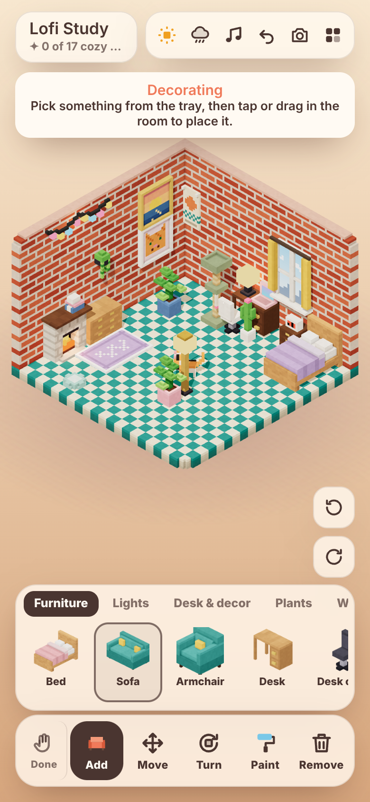

<p align="center"></p>

<h1 align="center">Lofi Rooms</h1>

<p align="center">Build tiny cozy isometric voxel rooms on your phone or on the web. Switch on the lamps, put a record on and let the cats wander.</p>

<p align="center">
  
  
  
</p>

A sibling of [Voxel Worlds](https://github.com/dalecri/voxel-worlds): same Explore and Edit idea, same touch controls, same Android build. Instead of landscapes, you make little rooms.

## Play in your browser

Once `main` is published to GitHub Pages: **[dalecri.github.io/Voxel-lofi-room](https://dalecri.github.io/Voxel-lofi-room/)**. It works on phones and computers.

To run it yourself:

```bash
python -m http.server 5180
```

Then open http://localhost:5180.

## What you can do

- **Decorate from scratch.** 40 voxel pieces in six groups:
  - **Furniture:** bed, sofa, armchair, desk, desk chair, coffee table, side table, bookshelf, dresser, TV, piano, fireplace, beanbag and two rugs.
  - **Lights:** floor lamp, table lamp, candles, fairy lights, wall lamp and a neon sign.
  - **Desk and decor:** mug, laptop, books, record player and a clock radio.
  - **Plants:** monstera, cactus, succulent, flowers and a wall planter.
  - **Wall:** window, paintings, posters, wall shelf, clock and mirror.
  - **Pets:** cats, cat beds and cat trees.
- **Small things stack.** Mugs, lamps, plants and records sit on desks, tables, dressers, bookshelves, the piano, the mantel and wall shelves. Move a desk and everything on it comes along.
- **Five decorating tools:**
  - **Add:** tap or drag to place.
  - **Move:** drag pieces around.
  - **Turn:** tap to rotate.
  - **Paint:** change walls (7 styles, 11 colours) and floors (8 styles), or tap any piece to cycle its colours.
  - **Remove:** tap to put things away.
  
  Beds, sofas, desks and shelves back up against the nearest wall on their own.
- **Tap things to use them:**
  - Lamps, the TV, the laptop, candles, fairy lights, the neon sign and the fireplace switch on and off.
  - The record player starts the lofi radio.
  - Windows open and close their curtains.
  - The piano plays a phrase and the clocks tell the real time.
  - Mugs steam, and plants enjoy a watering.
  - Tap the bed to sleep until morning.
- **Cats:** Cali (calico), Neo (tuxedo), Ramses (savannah), Diego (bengal) and Mochi (grey).
  - They wander, hop onto sofas, beds, chairs and cat trees, and nap in cat beds.
  - Tap a cat to pet it and it purrs.
- **Generative lofi music.** Warm 9th chords, a lazy swung beat, a bassline and vinyl crackle, all synthesized live, so there are no audio files. Rain and the fireplace have their own ambience.
- **Time of day and weather.** Morning, afternoon, evening and night follow your clock, or you can tap the sun to pick one. Rain streaks the windows. At night the lamps light the room.
- **Turn the room.** Walls facing you are cut away automatically, the same way the Sims does it, so you can decorate all four walls.
- **Several rooms.** Start from a template (Lofi Study, Cat Loft, Reading Nook, Empty Room) or tap **Surprise** for a random themed room. Tap the room name to rename it.
- **17 cozy moments** to find, such as *Night owl*, *Cat nap* and *Sweet dreams*.
- **Photo mode** crops to a 4:5 portrait that's ready for Instagram. In the app, **Share** sends it straight to other apps.
- **Undo** for everything. Rooms save automatically, and in the app they live in an on-device SQLite database.

## Controls

| | Phone | Computer |
|---|---|---|
| Look around | Drag, pinch to zoom, double-tap to zoom in | Drag, wheel |
| Use something | Tap it (Explore) | Click it |
| Decorate / done | Decorate button / Done | <kbd>X</kbd> |
| Pick a tool | Tool bar | <kbd>1</kbd>–<kbd>5</kbd> |
| Turn the room | Two-finger twist or the turn buttons | Right-drag, <kbd>Q</kbd> / <kbd>E</kbd> |
| Pan | Two-finger drag | Middle-drag |
| Lofi radio | Music chip or the record player | <kbd>M</kbd> |
| Undo | Undo chip | <kbd>U</kbd> or <kbd>Ctrl</kbd>+<kbd>Z</kbd> |
| Random room | Surprise | <kbd>R</kbd> |

## Install on Android

Every push to `main` builds an APK and publishes it as the [**latest release**](../../releases/tag/latest). Download `lofi-rooms.apk` on your phone, open it and allow installs from your browser. Every build is signed with the same committed debug key, so updates install over the old version and keep your rooms.

To build it yourself you need Node 22, JDK 21 and the Android SDK:

```bash
npm install
npm run apk        # → dist/lofi-rooms.apk
```

`npm run build` assembles `www/`, which is the app plus local copies of three.js, the fonts and Capacitor, so the APK works offline. `npm run icons` regenerates launcher icons and splash screens from `resources/`, which are rendered from the app itself.

## How it's made

| File | What it does |
|---|---|
| `room.js` | The room model. The furniture catalog (each piece is a voxel model built in code), wall and floor styles, placement rules, the templates, the random room generator and the save format. It doesn't draw anything, so it runs in Node too. |
| `render.js` | The three.js renderer. A voxel mesher with baked ambient occlusion, the cut-away room shell with stepped corners, furniture sync, lamp lights, the day cycle, cat behaviour, particles and picking. |
| `main.js` | Touch and mouse input, the decorating tools, things you can tap, rooms and saving, cozy moments, photo mode and the Android back button. |
| `sound.js` | The generative lofi band, ambience and interface sounds, all made with Web Audio. |
| `storage.js` | Mirrors saves into SQLite inside the app. |
| `android/` | The Capacitor Android project (app id `com.lofirooms.app`). |

You can try the room model without a browser:

```bash
node -e "const LR=require('./room.js'); const r=new LR.Room(); r.generate(42); console.log(r.name, r.items.length, 'pieces')"
```
